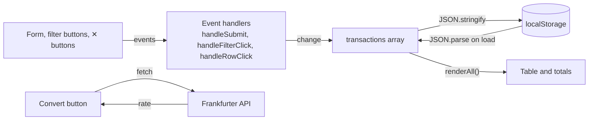

# Pocket Budget

A small budget page: record income and expenses, see your totals, filter and sort the list, and
convert your balance to another currency with today's exchange rate.

**Live:** https://giorgosfoteinopoulos.github.io/pocket-budget/

Built with plain HTML, CSS and JavaScript only: no framework, no build step, no server of its own.
It was made to practise JavaScript fundamentals step by step, one Jira story at a time.

## Features

- Income, expenses and balance at the top, with the balance in red when it goes negative
- Add a transaction from a form, with checks for the description, the amount and the date
- Show all, only income or only expenses, newest first
- Delete a transaction (with a confirmation)
- Everything is saved in the browser (`localStorage`), so it survives a refresh
- Convert the balance to USD, GBP, CHF or JPY with the latest rate from the
  [Frankfurter API](https://frankfurter.dev) (European Central Bank reference rates, no key needed)
- "Reset to sample data" to start again

## Run it

Download or clone the repository and double-click `index.html`. That is all: the page needs no
server. Only the currency conversion needs an internet connection.

## How it works



The rule the whole page follows: **change the data, save it, then draw the page again from the data.**
The page never moves rows around by itself.

## What each step practised

| Story | Topic | Main ideas |
|---|---|---|
| PB-2 | Values, variables and types | `let` / `const`, numbers, strings, `typeof`, template strings, why `'10' + 5` is `'105'` |
| PB-3 | Functions and decisions | functions, `return`, `if` / `else`, `===` vs `==`, arrow functions |
| PB-4 | Arrays and objects | a list of transaction objects, `for...of`, adding up totals |
| PB-5 | The DOM | `getElementById`, `createElement`, `textContent`, `append` |
| PB-6 | Events and forms | `addEventListener`, `preventDefault`, input values are strings, `Number()`, `NaN` |
| PB-7 | Array methods | `filter`, `find`, `map`, `sort` with a comparator, ids, event delegation |
| PB-8 | Saving in the browser | `localStorage`, `JSON.stringify` / `JSON.parse`, `try` / `catch` |
| PB-9 | Talking to an API | `fetch`, `async` / `await`, network errors vs error statuses, `finally` |

## Project layout

```
index.html        the page: totals, convert form, add form, filters, table
css/styles.css    the styles
js/app.js         all the JavaScript, in sections per story
```

## Notes

- Your data stays in **your** browser. Opening the page from another browser, another computer, or
  another address (for example `file://` instead of the live link) starts from the sample data.
- Amounts use JavaScript numbers, which is fine for a practice project. Real money apps usually store
  whole cents to avoid rounding surprises such as `0.1 + 0.2 = 0.30000000000000004`.